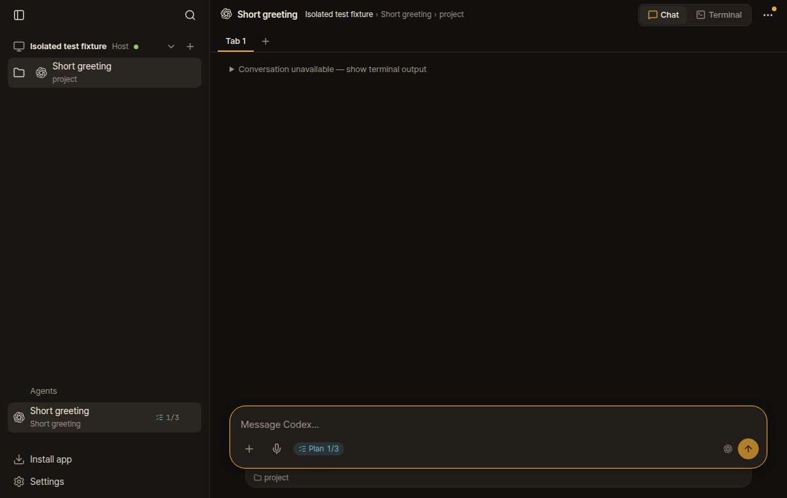
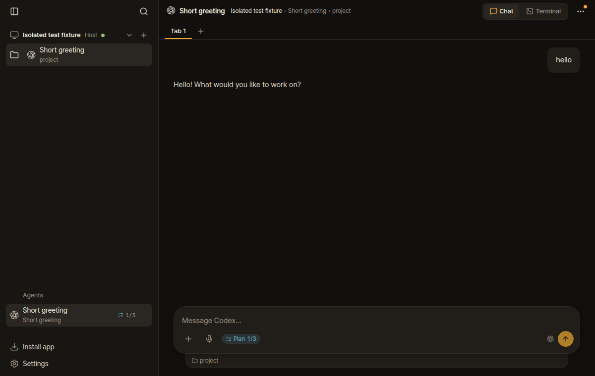
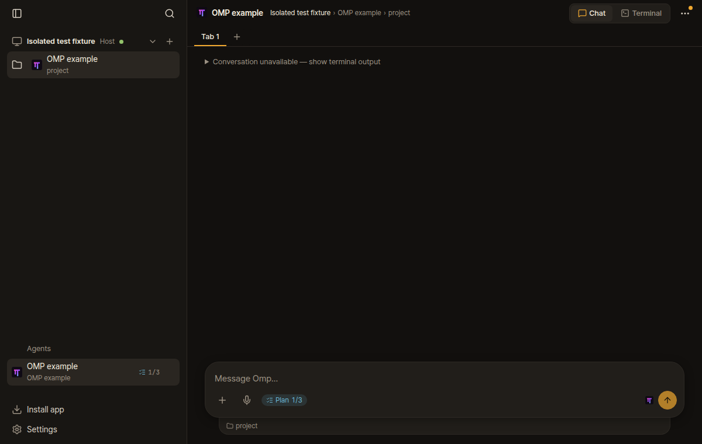
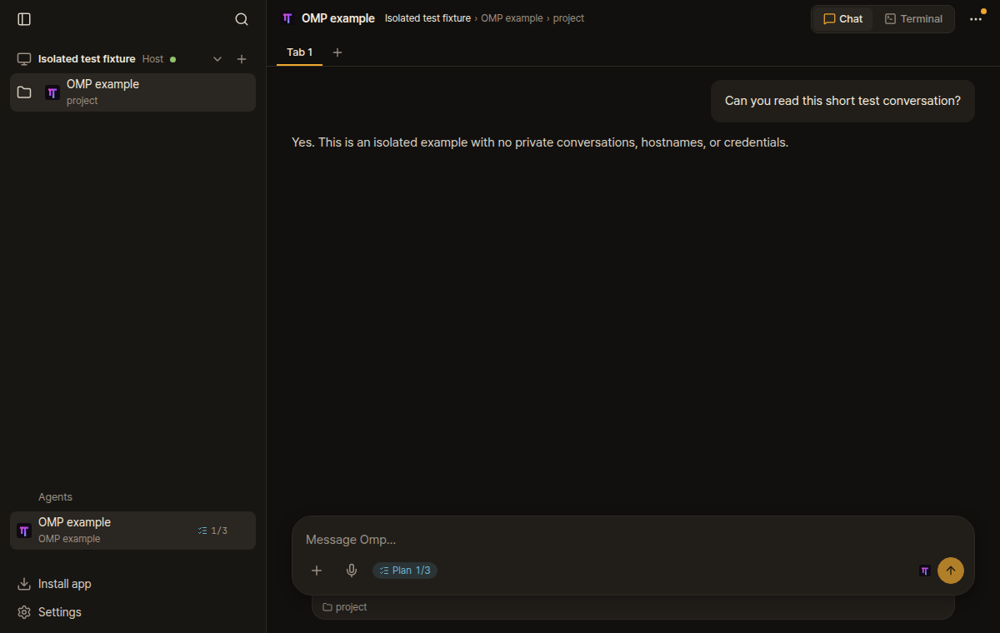
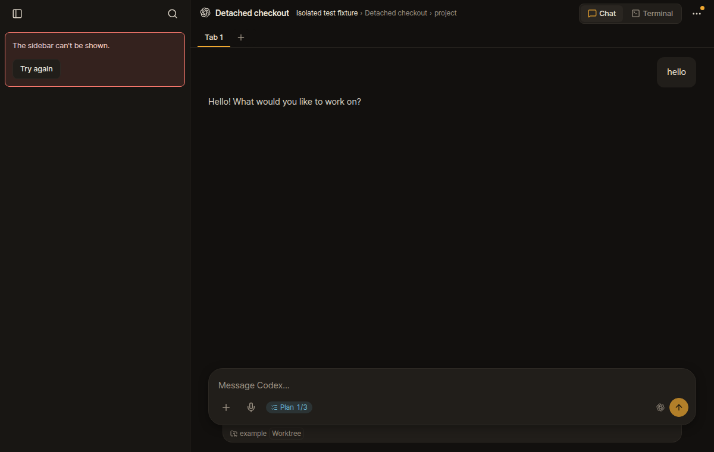
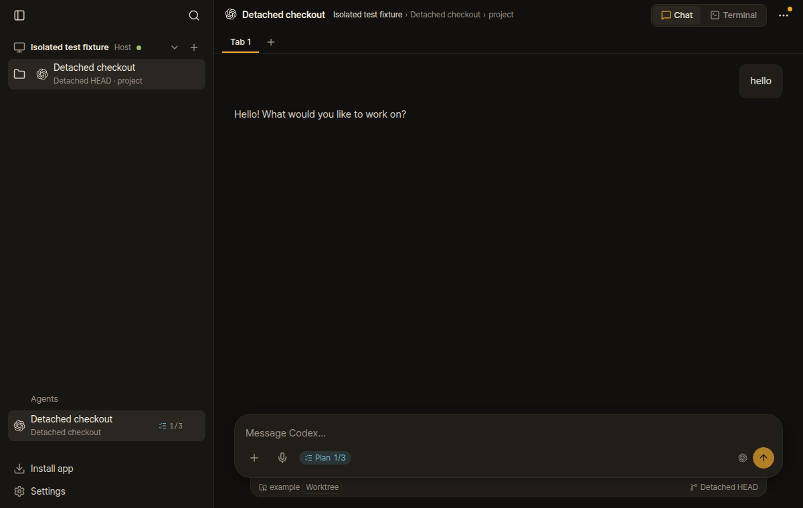

# Herdr Web UI bug reproductions

Before/after screenshots for three independent fixes: short Codex first exchanges, OMP foreground processes without `argv`, and detached-worktree sidebar rendering.

These are isolated fixture replays, not screenshots of a user's sessions. The Codex and OMP fixtures call the real native transcript resolvers with a temporary SQLite/JSONL store and controlled Herdr RPC responses. OMP uses an owned stand-in process holding its fixture transcript open. No coding agent or paid model runs.

The screenshots render those resolver results through each checkout's browser demo transport. The sidebar fixture returns an open detached worktree with its `branch` property omitted; its chat content stays identical before and after. This demonstrates the UI symptoms without claiming a full SSH/browser integration test. Separate live dogfooding is described in the PRs.

## Reproduce

Requires Linux, Bun 1.4+, Node, Git and Chrome. Use a fresh output directory. The helpers start and stop only their own fixture process and loopback server; they do not connect to an existing Herdr session.

```sh
git clone https://github.com/devswha/herdr-web-ui.git before
git -C before checkout 79beb36a82e0ca2eff7ab995c774b290af52a9b8
git clone https://github.com/christso/herdr-web-ui.git after
git -C after checkout d7a2982ac1b47911cab5e3c80fe47bd62abb8f44
(cd before && bun install --frozen-lockfile)
(cd after && bun install --frozen-lockfile)
bun native-replay.ts ./before ./after ./replay-output
bun screenshots.ts ./before ./after ./replay-output
```

The screenshot helper uses `/usr/bin/google-chrome`; adjust its `executablePath` if Chrome is installed elsewhere. Expected native output: before, neither transcript resolves and both return zero turns; after, both resolve to the intended file and return two turns. Expected sidebar: before, a caught render error and no workspace row; after, a working row labeled Detached HEAD.

The `after` commit combines the three independent fixes so one replay can exercise all of them. Each upstream PR has its own regression coverage and branches directly from upstream main.

## Captures

| Case | Before | After |
| --- | --- | --- |
| Codex |  |  |
| OMP |  |  |
| Sidebar |  |  |

No tokens, pairing codes, device cookies, real hostnames or user transcripts are included.
