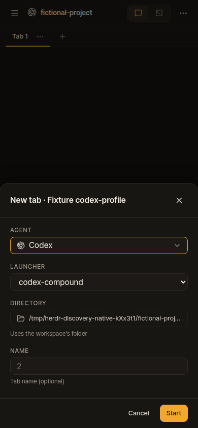
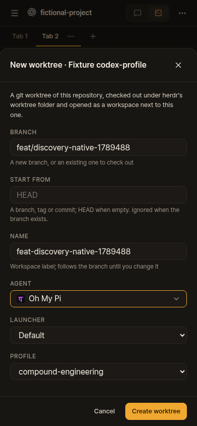
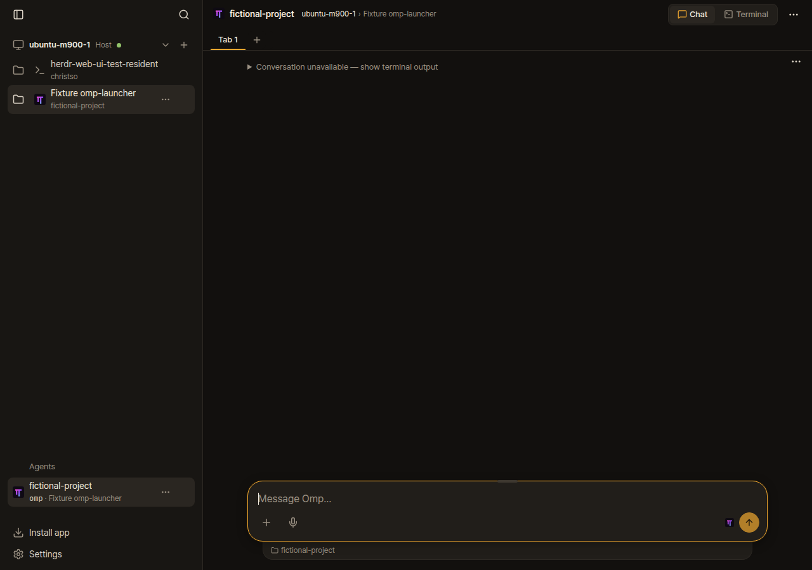
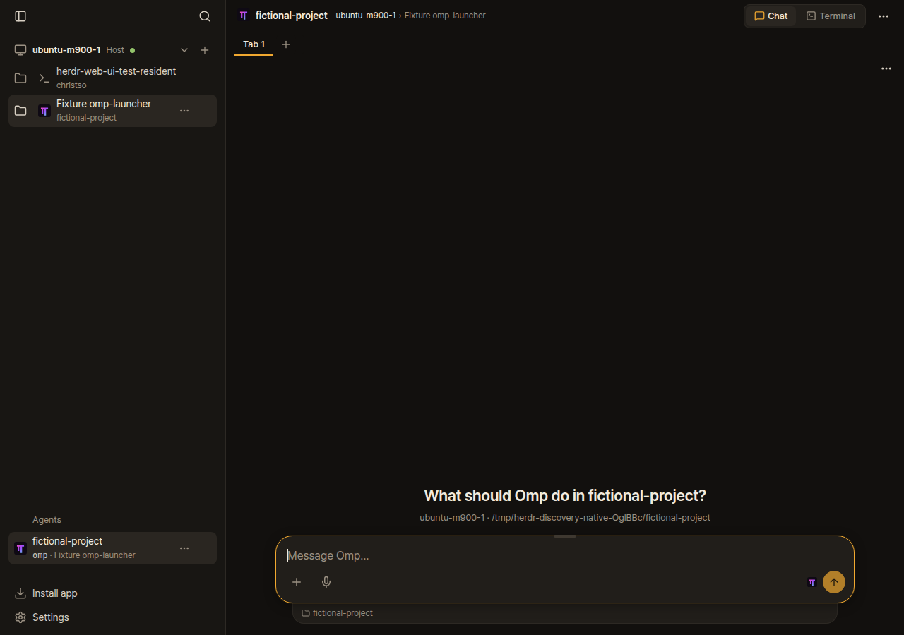

# Existing profiles and launchers: fork preview

[Fork commit 2942c44](https://github.com/christso/herdr-web-ui/commit/2942c44cfd9ffc4685a04d576fe0e9481024e683) replaces the earlier manual catalog with automatic discovery for [feature request #1197](https://github.com/devswha/herdr-web-ui/issues/1197). No upstream feature PR has been opened; that awaits agreement on the approach.

Choose an Agent, then its installed Launcher or native Profile. Labels use exact IDs. A custom launcher owns its configuration, so selecting one hides Profile. Each PC supplies its own choices. Codex and OMP have native profiles; Pi and Claude Code use installed shell launchers for separate configurations.

| New tab: custom launcher | New worktree: native profile |
| --- | --- |
|  |  |

[Desktop tab](new-tab-launcher-desktop.png) · [Desktop worktree](new-worktree-profile-desktop.png)

These are agent-browser CLI captures from disposable Herdr sessions and a fictional project. Real Codex 0.163.0, OMP 18.11.1 and Pi 1.2.0 reached the expected native agent kind at idle. Codex used a fixture adapter with --no-daemon. Offline providers prevented model calls. No prompts were sent.

The browser selected and submitted a Codex launcher tab and an OMP native-profile worktree. Both desktop and phone forms were checked. The worktree remained selected and showed its empty Chat greeting. The [native report](report.json) records source hashes and exact results. Native Codex/OMP profiles and OMP/Pi launchers showed greetings. Opaque Codex launchers can still show Conversation unavailable before their first message; they may resume history, so this change does not declare them fresh. That limitation remains #1191.

The deployed workstation, WTG and Spectre were checked on desktop and phone against their actual discovery APIs, including Claude. This live check opened forms only: no sessions, terminal attachments, prompts or private screenshots. See the [live report](live-verification.json). Claude Code was installed on the workstation and verified from zsh. Its launcher contract used a controlled stand-in; authenticated Claude startup was not tested, and no existing Claude custom launcher was found.

## Red and green evidence

An OMP configuration root outside the default .omp directory was discovered but its conversation was rejected. The reader now uses the same native root. These captures use the same disposable native OMP setup, before and after the fix:

| Before | After |
| --- | --- |
|  |  |

A creation-only remote link previously opened the local PC's form. It now targets the linked PC, and a missing PC never silently creates locally. [Before](creation-link-red.png) · [After on phone](creation-link-green.png).

Phone worktree creation also lost its selection while waiting for the roster. A committed browser regression now holds that roster and exercises creation, Back and Forward. Its [red](checks/worktree-forward-red.log) and [green](checks/worktree-forward-green.log) logs preserve the observed failure and result.

## Verification and limits

- [Fast checks](checks/fast.log): workflow syntax, generated types, typecheck, build and 3,820 unit tests passed; 8 skipped across 295 files.
- [SSH integration](checks/ssh.log): a fresh remote bundle passed installation, isolation, terminal/input, files, conversations, reconnect, update and trust checks.
- [Launcher contracts](checks/claude-contract.log): seven passed, including Claude configuration ownership and conservative wrapper freshness.
- [Independent review](review/review.json) covered nine lenses. The [OMP/Claude follow-up](review/followup-review.json) and [final phone closure](review/followup-phone-final-review.json) closed all confirmed findings. Reviewers made no source edits.

Broader browser CI is not claimed green. The deep-link suite has baseline keyboard-focus failures; a private diagnostic preserving the other assertions passed 16 cases before a More/Cancel animation timeout. The full API contract suite also has three failures reproduced on the unchanged baseline; the changed metadata case passed all original assertions. A restricted-PATH native probe discovered all choices and launched five real clients, but its later dialog request timed out; the complete native/browser report above uses the normal runtime PATH. No native macOS/Windows check or upstream CI approval is claimed.

Screenshots, reports and personal notes stay on this fork's orphan evidence branch. They are absent from the application branch and upstream PRs.
