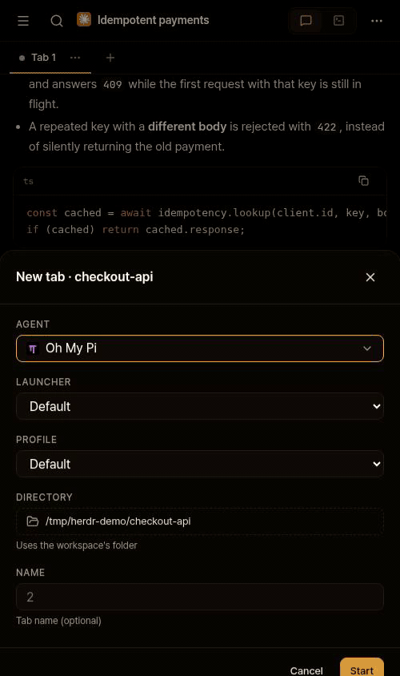

# Profile and Launcher interaction

This 7.6-second agent-browser recording uses the production UI at fork commit
2942c44, with the bundled fictional demo transport. It shows the New tab form at
500 x 844. No agent was started and no prompt or model call was made.

[MP4 version](profile-launcher.mp4) - [asserted UI states](report.json)

1. Select OMP with Launcher set to Default. Profile is available.
2. Select the native compound-engineering profile. This choice uses the ordinary
   OMP launcher with --profile compound-engineering.
3. Select omp-compound. The native profile choice is cleared and Profile hides;
   the custom wrapper owns its configuration.
4. Return Launcher to Default. Profile returns at Default.

A native Profile belongs to its Agent and works with the Default launcher. It is
not assigned to a custom wrapper. The recording verifies form behavior, not the
contents of a wrapper or an agent launch. Native-client evidence is in the parent
directory. This folder is on the fork's separate orphan evidence branch and is
absent from application branches and upstream PRs.
