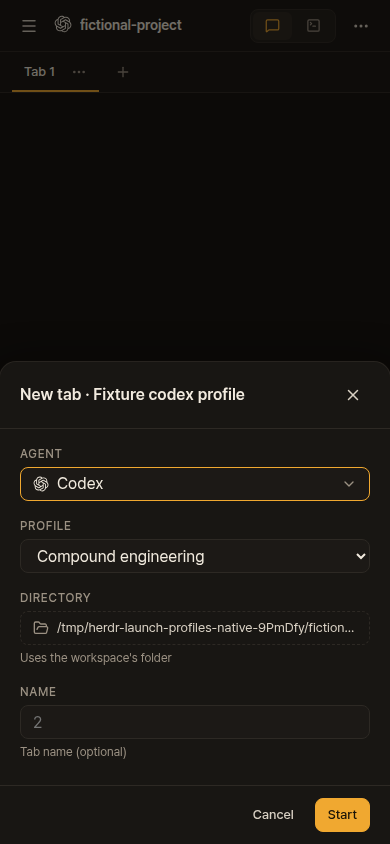
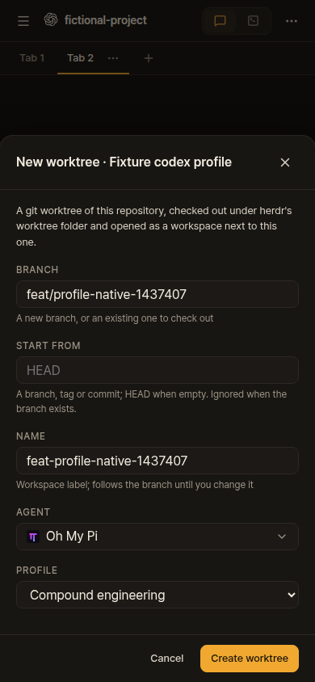

# Launch profiles: working fork preview

Fork commit [b8b8655](https://github.com/christso/herdr-web-ui/commit/b8b8655bf61aada3b9dad310634505ee58be5b82) adds a Profile field below Agent in New workspace, New tab and New worktree. It is an experimental fork feature for [upstream request #1197](https://github.com/devswha/herdr-web-ui/issues/1197), pending agreement on the upstream approach. The earlier design mockups remain one directory above.

These are actual agent-browser CLI captures from disposable Herdr sessions and a fictional Git project. They contain no user conversations. The profile catalog and agents were real; browser requests were observed, not mocked.

| New tab | New worktree |
| --- | --- |
|  |  |

[New tab desktop](new-tab-profile-desktop.png) · [New worktree desktop](new-worktree-profile-desktop.png)

Native Codex 0.163.0 with --profile, OMP 18.11.1 with --profile and Pi 1.2.0 with a custom configuration directory each reached its expected native agent kind at idle. Chat showed an empty greeting with no unavailable message or sidebar error. Codex used --no-daemon to keep the disposable test from creating a background daemon. Offline fixture providers were configured; no prompts or model calls were made.

The browser also chose profiles and submitted New tab (Codex) and New worktree (OMP), then switched to Chat and verified the greeting. Desktop uses its existing Auto view preference; a successful launch need not open Chat automatically. Desktop and phone captures are 1280x900 and 390x844. [Native/browser report](report.json) binds runtime source hashes to these checks.

The installed site was checked separately with agent-browser, without creating sessions or taking private screenshots: local Codex and remote OMP/Pi offered their own profiles; changing the base agent reset Profile to Default; the phone dialog had no horizontal overflow and its Start button was visible. [Installed-dialog report](live-dialog-verification.json).

Verification:

- Fast checks passed: workflow syntax, generated types, both TypeScript configurations, build and 3,809 unit tests (8 skipped, 294 files).
- Five isolated HTTP contracts passed, including literal argument execution, default launch behavior, refusal before creation and preserving blocked panes.
- The final four additional pre-write refusal tests passed with the original shell tests (11 total), followed by typecheck and all 25 conventions tests. Existing assertions were preserved.
- A freshly built Linux remote bundle passed the complete isolated real-SSH integration suite: install/authentication, two independent daemons, terminal/input/files/conversations/prompts, reconnect/offline behavior, idempotent update and cleanup.
- [Independent review](review/review.json) completed nine review lenses. Both confirmed findings, remote configuration documentation and missing refusal coverage, were fixed and independently closed in the [follow-up receipt](review/followup-closure.json). Production source hashes did not change after native/browser proof.

An initial local rerun hit the temporary filesystem quota; completed dependency fixtures were moved to the workstation cache before the passing runs. Earlier browser-driver attempts also needed catalog-load and sheet-animation waits. Those failed attempts are not represented as passing checks.

This does not solve arbitrary agents started manually in a terminal (#1191). Only host launchers explicitly declared fresh get an empty greeting without transcript evidence. Native Herdr is unchanged. Linux is verified here; no native macOS/Windows result or upstream CI approval is claimed. A delayed old-machine catalog response has code-level cancellation and machine scoping, but no dedicated delayed-response UI regression was added.

All screenshots and personal verification notes live on this fork's orphan evidence branch. None is part of the application branch or an upstream PR.
