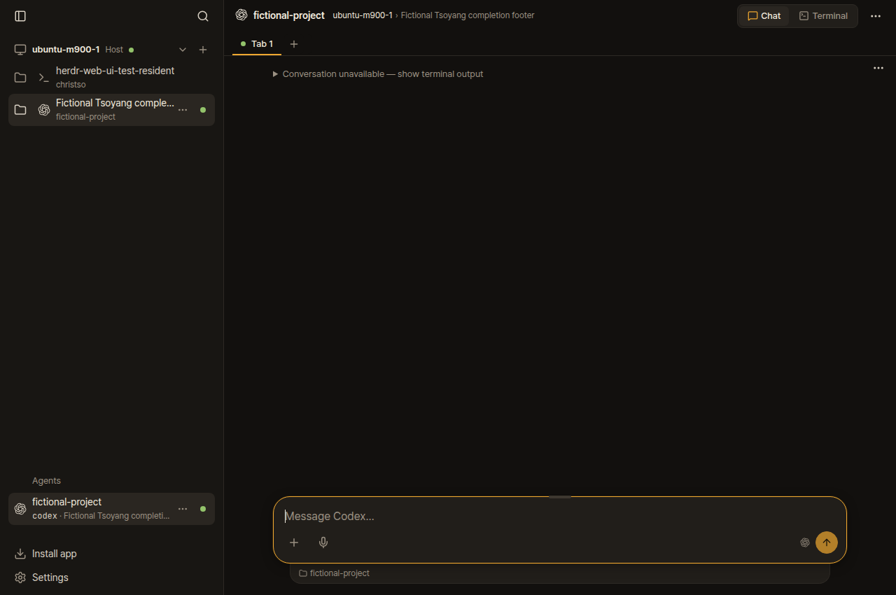
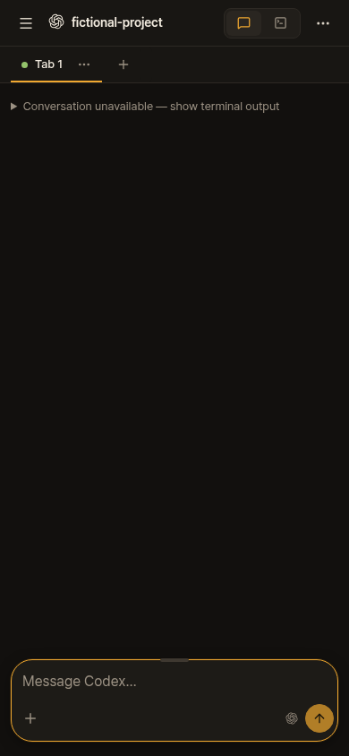
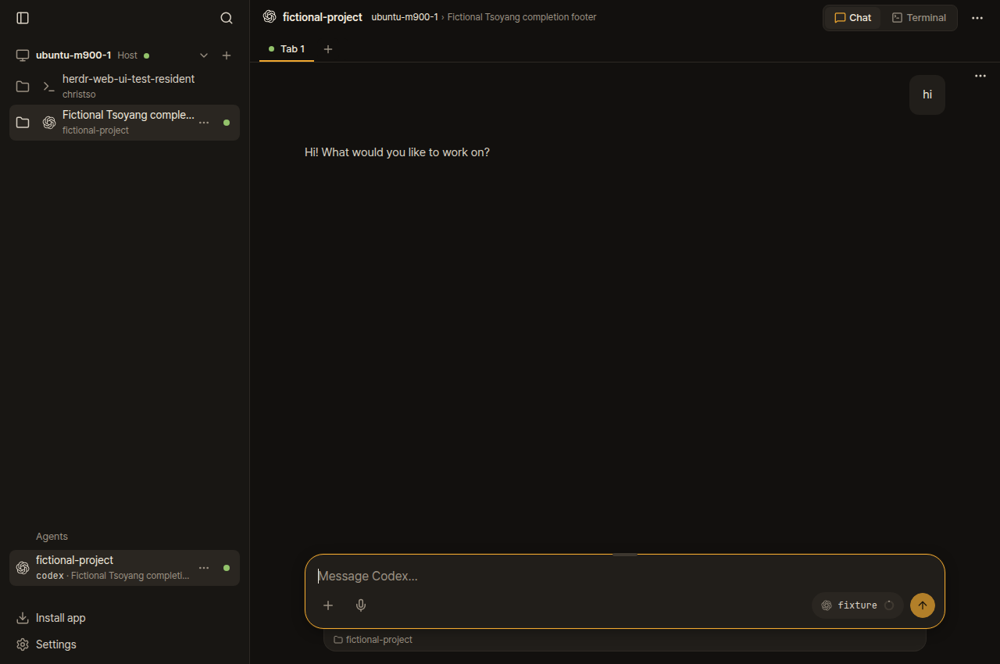
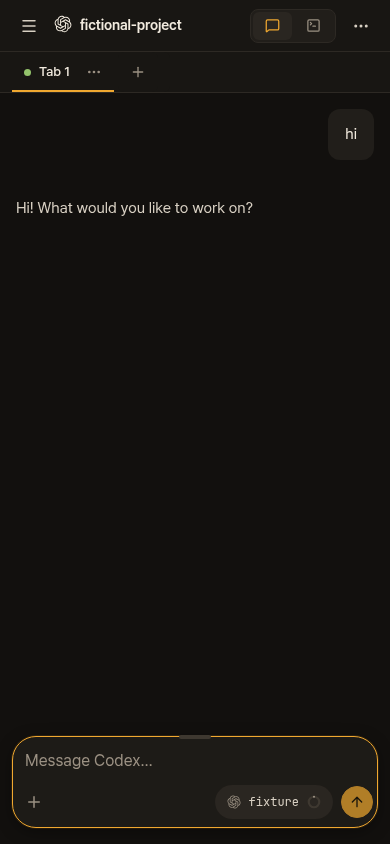

# Codex: Chat disappears after the first reply

A fresh Codex-Tsoyang tab showed its greeting, then “Conversation unavailable” after a short reply. The conversation was saved correctly. The first-answer matcher included Codex's completed-turn footer in the answer it compared with the transcript.

For example, the terminal showed a short greeting followed by `Worked for 1s • 11:11 AM`. That footer is absent from the saved answer, so the exact comparison failed. The fallback used for longer replies could conceal the defect in earlier checks.

[Fix e56c5f7](https://github.com/christso/herdr-web-ui/commit/e56c5f7fe8c100fbf71abaf720e97c6ca9389997) excludes a recognized trailing completion footer separated from the answer by a blank line. It supports the observed subsecond form too: `Worked for <1s • 11:19`. Exact answer comparison, process timing, store boundaries and competing-conversation checks remain.

The fix is on christso/main and deployed on ubuntu-m900-1 and Spectre. WTG remains paused and was excluded.

## Native reproduction

This replay runs the installed Codex 0.163.0 binary inside an isolated native Herdr 0.9.5 session. An owned wrapper selects a temporary CODEX_HOME and passes --add-dir for a fictional vault, matching the relevant Codex-Tsoyang launch behavior. It uses an empty configuration and a local Responses API server that returns a short fictional reply. No real credentials or model calls are involved.

The script creates the session through the web API, verifies the greeting in agent-browser, sends hi through the actual web composer, and waits for Codex itself to render the answer and footer. It then opens that same owned pane through the pre-fix and patched servers. The client screens are native output.

| App reader | Desktop | Phone |
| --- | --- | --- |
| Before, 424dcde |  |  |
| Patched |  |  |

The pre-fix endpoint returns empty scrollback; the patched endpoint returns the two saved turns. Both browser sizes assert the corresponding warning or reply, and phone captures wait for the drawer to close. [Native assertions](native-report.json), [captured fictional terminal](native-screen.txt), [replay script](native-browser.ts).

The replay imports its preserved 424dcde server copy from the local before directory and the current checkout from the repo path defined in the script. From that checkout, run it through its isolated test runner:

```sh
TMPDIR=/home/christso/.cache/herdr-profile-qa bun run check run --build bun /path/to/native-browser.ts
```

## Why the earlier verification missed it

The preceding profile checks used simulated terminal output without Codex's completion footer. Those checks covered fresh launch markers and separate stores, but did not reproduce this post-reply layout. This follow-up uses the actual client and short reply. It first failed again on the native <1s duration, which became an additional failing regression before the final patch.

Existing tests are unchanged. Added tests cover recognized durations and clocks, a literal footer-shaped answer, unknown or continued footer text, overlapping older conversations and a profile conversation containing two short turns with source vscode.

Fast checks passed: 3,897 unit tests, zero failures and eight skips across 300 files, plus type checking, build, generated types and workflow syntax. The final combined native-browser and endpoint run passed, including 22 contract tests with 173 assertions. Both final runs verified that source stayed unchanged; the committed reader hash matches the tested code. An earlier fast run was interrupted with exit 143 and is not counted as a pass. [Validation](validation.json), [fast check receipt](fast-check-report.json), [native and contract receipt](native-check-report.json).

Focused correctness and independent adversarial review found no outstanding issues. The cross-model route did not run because its acpx transport failed before egress with npm ETARGET; the independent in-process reviewer covered that lens. [Review receipt](review.json).

## Deployment check

The installed reader's file hash matches the fork commit. Two existing Codex conversations still resolve, and production desktop/phone checks passed with no render errors. Configuration, machine registrations and the native Herdr socket were preserved. Spectre's new managed bridge and all 120 source hashes were verified. [Host check](deployment.json), [Spectre check](remote-verification.json), [production browser](production-browser.json).

The reported wT:p7 pane and its process had already closed before deployment began. The patched reader resolved its four saved turns while it was open; there is no claim of a live post-deployment recovery of the closed pane. No input was sent to it. Production browser checks used an existing control conversation, blocked terminal attachments and took no user screenshots.

These test notes and screenshots live only on the fork's orphan dogfood/evidence branch. Application branches contain code, tests and the changelog fragment.
