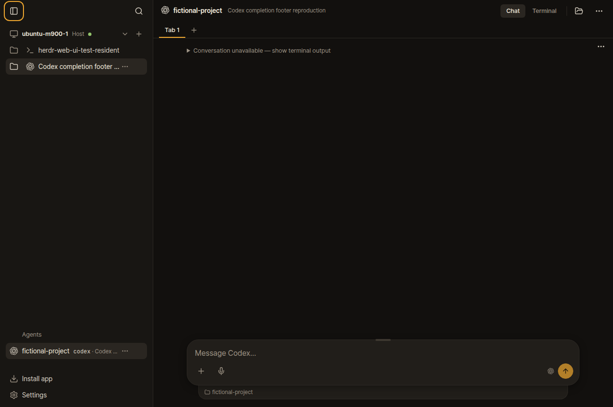
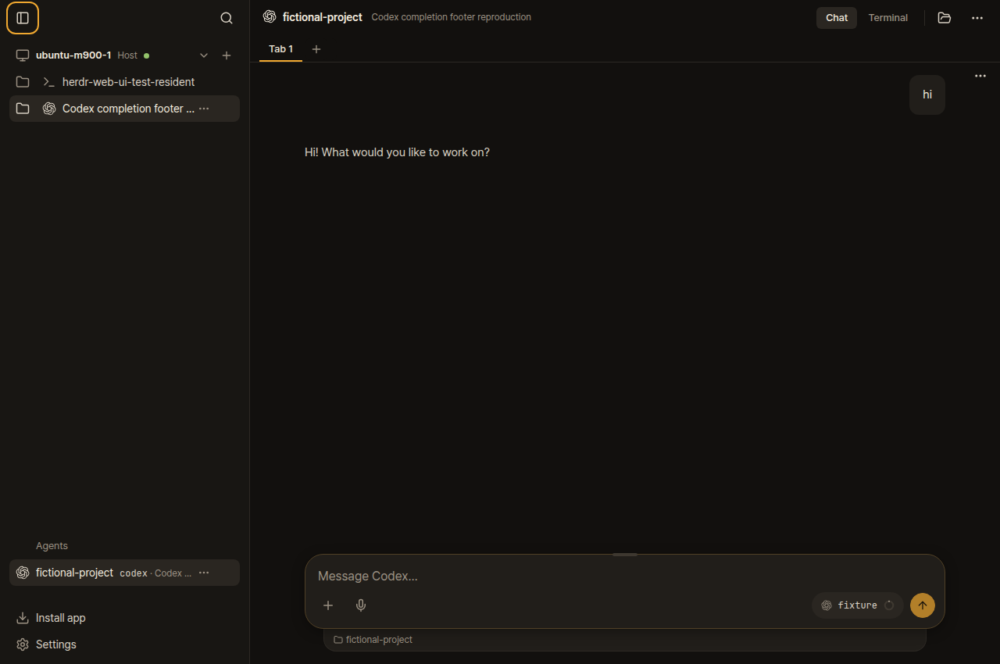
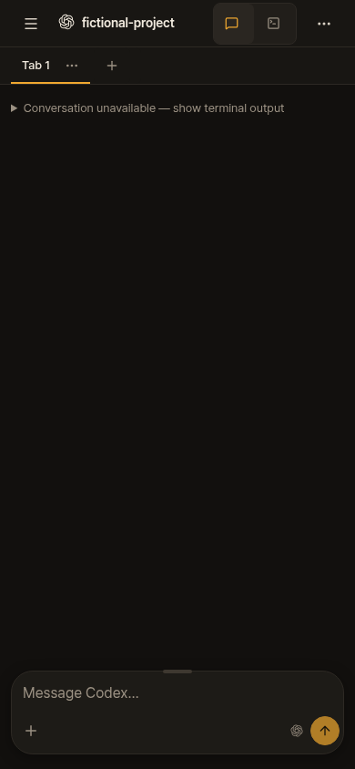
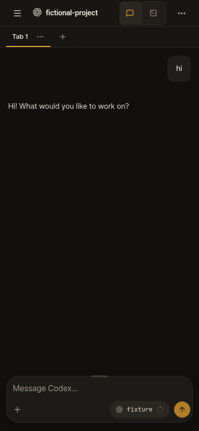

# Codex short replies with completion footers

A real Codex 0.163.0 process printed a short answer followed by its native
`Worked for <1s • 13:24` footer. The unchanged upstream reader at
`95507e2ea66c53eefaed58dd923ec21111118a2e` returned no conversation.
The focused fix displays the saved user message and answer in Chat.

The browser captures use one owned pane in an isolated native Herdr 0.9.5 session,
temporary Codex configuration, and a local Responses API with a fixed answer.
The replay sends `hi` in that terminal, then compares both Chat readers in the browser.
No live model call or user credential is needed. Both readers inspect the same native
pane and transcript. The desktop viewport is 1280×850; the phone viewport is 390×844.

| Before | After |
| --- | --- |
|  |  |
|  |  |

## Replay on Linux

Install Bun, Node, native Herdr, Codex 0.163.0, agent-browser CLI and Google Chrome.
The script uses `/usr/bin/google-chrome`. Use the native Codex binary, rather than a
personal launcher, for `HERDR_FOOTER_CODEX_BIN` if needed.

```sh
git clone https://github.com/christso/herdr-web-ui.git herdr-footer-repro
cd herdr-footer-repro
git checkout c5accd5cfcd430a71afc5802f41489544448aa5e
bun install --frozen-lockfile
bun run build
evidence=$(mktemp -d "$HOME/.cache/herdr-footer.XXXXXX")
mkdir "$evidence/before"
git archive 95507e2ea66c53eefaed58dd923ec21111118a2e server shared | tar -x -C "$evidence/before"
ln -s "$PWD/node_modules" "$evidence/before/node_modules"
ln -s "$PWD/dist" "$evidence/before/dist"
ln -s "$PWD/src" "$evidence/before/src"
curl -fsSL https://raw.githubusercontent.com/christso/herdr-web-ui/dogfood/evidence/docs/codex-completion-footer/upstream-follow-up/native-browser.ts -o "$evidence/replay.ts"
HERDR_FOOTER_EVIDENCE="$evidence" HERDR_FOOTER_TMPDIR="$HOME/.cache" bun run check run bun "$evidence/replay.ts"
```

Expected: the report prints `red: scrollback, 0 turns` and `green: codex-transcript, 2 turns`.
The script closes only its own browser and workspace; the check runner stops its isolated Herdr.
Screenshots and JSON results go into `$evidence`.

## Validation

- Fast checks: 4,166 passed, zero failures, eight skips across 321 files.
  Workflow syntax, generated types, TypeScript and the production build passed.
- Codex API contracts: 14 passed.
- New footer tests on unchanged upstream: 117 passed, two expected failures.
- Two independent read-only reviews: no remaining findings. Review found a literal trailing
  footer-shaped paragraph case, now covered along with competing-answer rejection.
- Host and Spectre run the same completion-matching functions as this PR. Production browser checks found
  existing chats available on desktop and phone, with no browser errors.
- WTG was left untouched.

Earlier check attempts hit the host's `/tmp` quota, then transient resource failures and an
existing directory-order assertion on disk. The unchanged upstream assertion failed in the
same disk environment. The final full fast run used `TMPDIR=/dev/shm` and passed without
changing those tests. This folder is evidence on the fork's orphan branch; it is absent
from the upstream PR.

Final PR head: `c5accd5cfcd430a71afc5802f41489544448aa5e`. Deployed fork: `602750713227a424e55024b80730dad7333e26a8`.
The CodeRabbit readability comment was addressed and replied to. The final native replay
also stops the app-server daemon belonging to its temporary Codex home.
