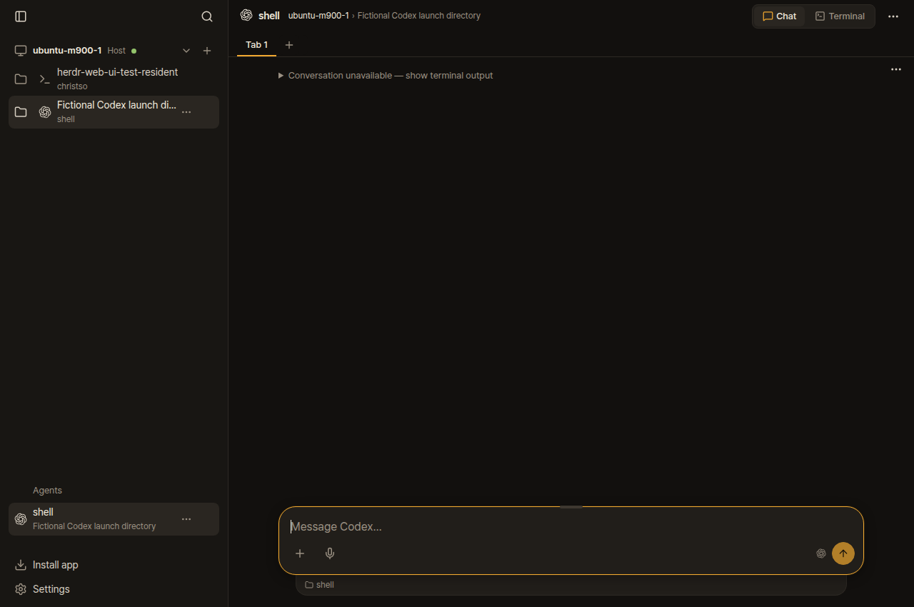
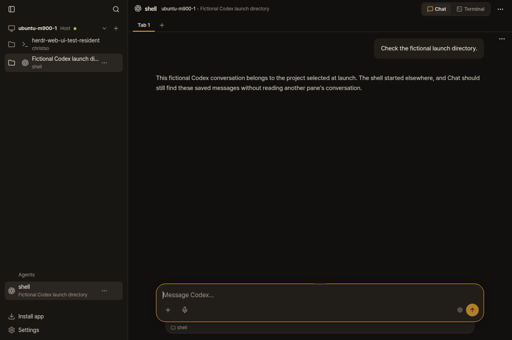

> Historical experiment: the argument parser below was reverted in 47f21b6. The current fork uses native process directories and confirms fresh launcher screens. See [Codex profile Chat checks](../codex-profile-chat-start/README.md).

# Codex launch directory lookup

Launching Codex from one directory with `codex --cd /path/to/project` can show
“Conversation unavailable” even after a completed reply. Codex records the chosen
project in its native session store, while Herdr can keep reporting the shell's
original directory. Chat searched that original directory.

The user confirmed the affected pane used `codex-tsoyang`, whose command selects a
profile workspace with `--cd`. A read-only native check could not resolve its
conversation under the shell directory and did resolve the exact saved file under
the `--cd` directory, matching a substantial reply on that pane's screen.

This is separate from a terminal-launched fresh Codex session lacking a transcript
before the first message (#1191). It is also separate from using a custom
`CODEX_HOME`: six existing Compound launcher panes already returned their saved
conversations on the previous deployed revision, including a two-turn control.
No input was sent to those panes.

The fork fix reads Codex's launch directory from the identified foreground
process's arguments and applies it to transcript lookup, background binding guards
and peer checks. Existing transcript ownership checks remain. Unknown peer
directories can prevent a weak match; they cannot establish positive ownership.

The owned browser fixture uses a stand-in Codex process, a fictional native JSONL
and SQLite store, an isolated native Herdr session and the real HTTP server/UI.
The same process starts in `shell` with `--cd project`. It makes no model calls.
Old backend revision `883f2b6` returns empty scrollback and shows unavailable; the
fixed backend returns two native turns and shows both messages. The screenshots
contain only that fictional session.

| Before | After |
| --- | --- |
|  |  |

Browser and endpoint checks run through the repository's isolated check runner:

```sh
bun run check run bun test server/codex-binding.contract.test.ts server/codex.contract.test.ts
bun run check run bun /tmp/herdr-codex-launch-directory/browser-qa.ts
```

The final commit, check totals, review follow-ups and deployment checks are recorded
in the accompanying reports. Personal scripts, screenshots and notes live only on
this orphan fork branch, outside upstream application changes.

## Verified result

The fix is commit [`70b4d4e`](https://github.com/christso/herdr-web-ui/commit/70b4d4efb3e66a61592195f5b61366800d051a2f), pushed to `christso/main` and deployed on the host, WTG and Spectre.

- 3,905 unit tests passed; 0 failed and 8 opt-in skips. Final typecheck passed.
- 135 focused Codex tests and all 15 native endpoint contract tests passed.
- All ten original binding tests and all 34 original assertions are unchanged.
  Their stand-in process now chooses fictional screen output through environment
  variables, rather than invented Codex CLI flags. Ten independent old/new script
  output comparisons were byte-identical.
- The revised fixture on old backend `883f2b6` has ten original passes and only the new
  directory regression failing. That regression uses a unique answer and closes
  its owned pane immediately, avoiding interference with the peer limit.
- Independent review found no retained issue after the corrections. The attempted
  Claude transport failed before code submission; the completed independent
  review was local.
- Agent-browser verified the affected live route on desktop and phone after
  deployment, without terminal attachments or personal screenshots. It rendered
  the existing ten-turn conversation. All six Compound controls still pass.
- Each remote's 120 backend source files match the fork; its new managed bridge
  identity and preserved native socket were verified. Host auth and remote
  registrations were preserved, and the user Codex process was not restarted.

To reproduce the user-facing condition manually, create two directories, start
Codex from the first with `codex --cd /absolute/path/to/the/second`, receive a
normal paragraph reply, then open Chat for that pane. The saved messages should
be read from the selected project. The recorded fixture supplies fictional saved
messages and terminal output instead of making a live model call.

An initial full-suite attempt hit the local disk quota while creating a large
history fixture; generated native libraries from completed owned tests were
removed and the full suite then passed unchanged. The final fixture-only edits
were followed by typecheck, endpoint and browser reruns.
