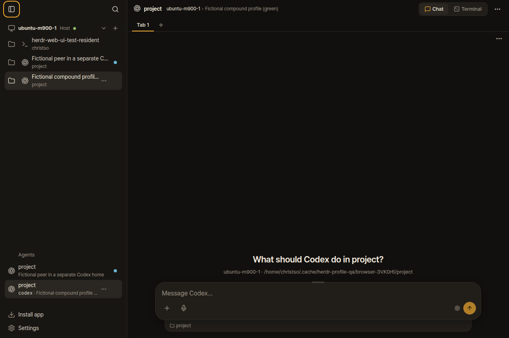
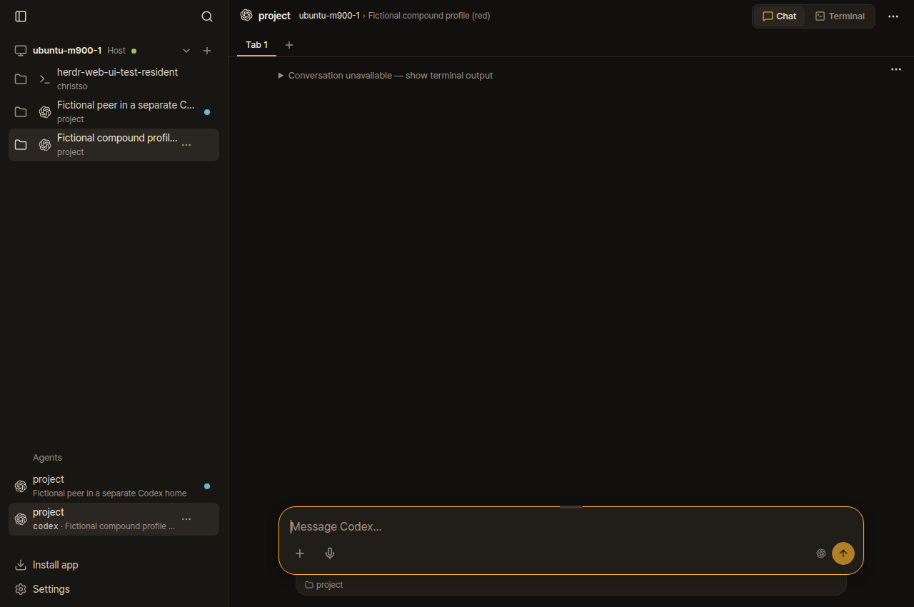
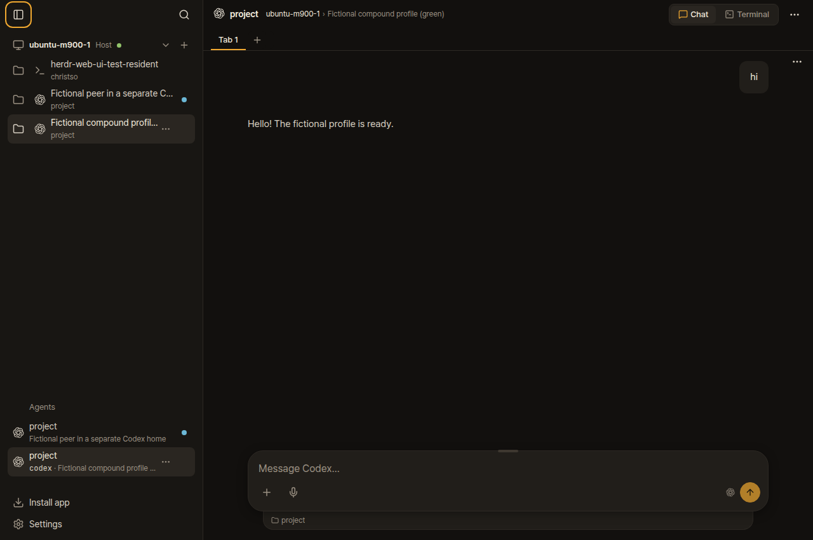

# Codex profiles in Chat

Fresh Codex sessions launched through the web UI now show the greeting before the first message, including custom launchers such as codex-compound and codex-tsoyang. A short first exchange can also be found when another profile in the same project is busy.

Application revision: [424dcde](https://github.com/christso/herdr-web-ui/commit/424dcde2ae3e44a90ed0aa8317ff274617aa55e7). Pushed to christso/main and deployed on ubuntu-m900-1 and Spectre. WTG is paused and was excluded from this deployment.

## What failed

Default and native-profile launches already had a fresh-session marker. Custom launchers did not, because a wrapper might resume an existing conversation. The patch confirms Codex is at its untouched composer before assigning that marker. Opaque wrappers, a resume picker and screens containing submitted messages or saved answers remain conservative.

Another Codex pane in the same project could veto a short first exchange even when it wrote to a different Codex home. Ownership checks now exclude only peers whose process identifies a genuinely separate store. Unreadable stores still leave ownership uncertain. Canonical paths keep symlinks and trailing slashes from making one store look like two.

For wrappers that change directory, the reader uses Herdr's native process directory. The earlier --cd/-C argument parser was reverted in 47f21b6 and remains removed. A running process created with that older command form needs a fresh launch; changing its launcher file cannot change the process already running.

## Browser reproduction

The browser script starts an isolated native Herdr session and serves both the pre-fix app and the patched app. Its owned stand-in Codex processes print fictional screens and write native-shaped SQLite and response_item JSONL records. No paid model call or user pane is involved. This verifies the actual API, transcript lookup and browser behavior; it does not claim a full live-model client round trip.

For each app version, it creates Default, native-profile, Compound and Tsoyang sessions through the web API. A separate-store peer is left working in Compound's project. Tsoyang's wrapper changes to another directory before exec. Each session is checked before input and after the fictional hi/reply exchange.

All 16 checks passed. Default and native profiles are controls: they work before and after the patch. Compound and Tsoyang fail both phases before the patch and pass both afterward. The browser asserts that the greeting and composer appear before input, and that the saved reply replaces the greeting afterward.

| Check | Before patch | With patch |
| --- | --- | --- |
| Compound, before first message |  |  |
| Compound, after first reply |  |  |
| Tsoyang, before first message | [Screenshot](red-tsoyang-before.png) | [Screenshot](green-tsoyang-before.png) |
| Tsoyang, after first reply | [Screenshot](red-tsoyang-after.png) | [Screenshot](green-tsoyang-after.png) |

[Browser assertions](browser-report.json) · [Replay script](browser.ts) · [Validation](validation.json) · [Independent review](review.md)

The replay uses the local checkout path in browser.ts and the preserved pre-fix source copy. Run it from the checkout with:

```sh
TMPDIR=/home/christso/.cache/herdr-profile-qa bun run check run --build bun /path/to/browser.ts
```

## Verification and deployment

Fast checks passed: 3,894 unit tests, zero failures and eight skips across 300 files, plus type checking, production build, generated types and workflow syntax. The focused run passed 152 tests, including 22 existing/new endpoint and launcher contracts. Existing assertions were preserved.

Two independent reviews checked standards and the requested behavior. Review caught and verified fixes for a peer with missing directory metadata and aliases to the same Codex store. Both final reviews have no outstanding findings.

[Host deployment](deployment.json) preserves configuration, machine registrations, the native socket and an existing Codex process. Two existing conversations still resolve. [Spectre verification](remote-verification.json) checks all 120 runtime source files and the new bridge process while preserving its native socket.

[Production browser checks](production-browser.json) passed at desktop and phone sizes, with no render errors. Those checks read an existing conversation, block terminal attachments and take no screenshots of user state. The originally reported pZ pane had closed by the final read-only inspection, so these results do not claim a live recovery of that closed pane. The legacy --cd pane was left running unchanged.

The first local rerun hit the temporary filesystem's user quota. Moving only this task's fixtures to disk-backed storage allowed the final runs to complete. An earlier browser run also passed its assertions but was invalidated when tests changed during the run; the published final browser check rebuilt and verified unchanged source.

These screenshots and testing notes exist only on the fork's orphan dogfood/evidence branch. They are absent from application branches and upstream PRs.
