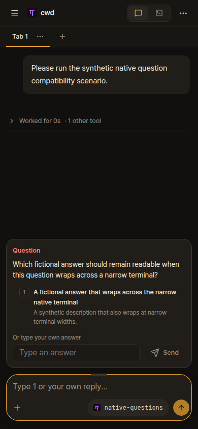

# Combined native check after both clipping cases

[Hosted run 38825790131](https://github.com/christso/herdr-web-ui/actions/runs/38825790131) passed on fork integration commit 5f07e144a1c9940adaaf4adacdbf20dc8b69f116, with parser SHA256 35b72f0b33cf258cc5ac7a4eb71b4e7ddc548e5f2b7519a40832213d6bcd89db. This combines upstream PR #1184's wrapped-row parsing and #1192's clipped legacy footer detection. The standalone clipped-footer branch does not claim wrapped-row support.

Native OMP 18.0.0 and baseline 18.10.4, Herdr 0.9.3, full web app and agent-browser CLI. Both lanes completed five cards: single choice, multiple choice, custom text, wrapped question and final review. The offline provider verified exact results for all four questions. The native narrow terminal was 47 columns and 83 rows; final phone captures are 390x844 with the workspace drawer closed. No user sessions, credentials or paid model call were used.

| OMP 18.0.0 | OMP 18.10.4 baseline |
| --- | --- |
|  |  |

The earlier Esc-clipped red/green reproduction remains in red/ and green/. A subsequent hosted failure exposed a distinct complete Tab/left/right control followed by an ellipsis; #1192 now accepts both with full preceding hints and aligned native option markers. Invalid or off-screen menus remain unavailable.

The CI harness phone transition also uses a fresh agent-browser session after explicitly closing desktop. Earlier runs failed by immediately reusing the exiting daemon's socket. The two-line lifecycle correction leaves every parsing, layout and native answer assertion unchanged; its independent review is beside this report. This change belongs to the separate CI PR #1187.

Replay through the fork workflow:

```sh
gh workflow run omp-question-compat.yml --repo christso/herdr-web-ui --ref christso/main -f omp_version=18.0.0
```

Reports bind the check to an exact commit and parser hash. This does not prove every historical release or layout. Upstream required CI and native Windows checks remain separate.
