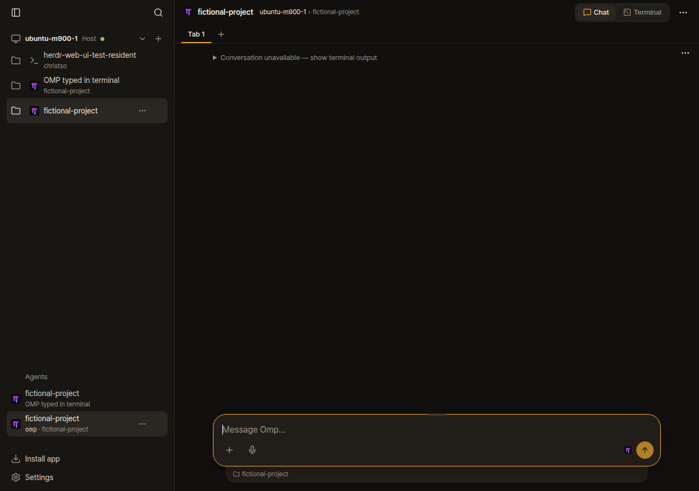
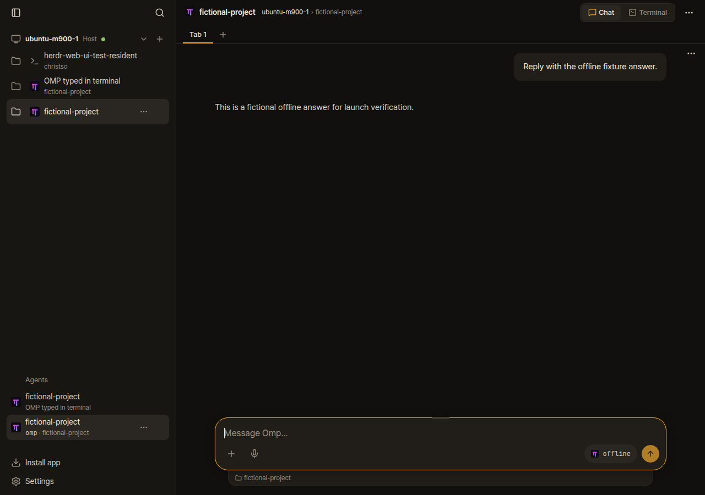

# Does launching OMP through the web UI avoid #1153?

It avoids the empty-chat error before the first message in the fresh sessions tested. It does not reliably avoid the saved-conversation failure in #1153.

## What was tested

An isolated Herdr 0.9.5 session, upstream Herdr Web UI `aa624cb56f550f9a7dd8bf4d59ed99ffc3921741` (0.4.10), real OMP 18.4.2 and 18.11.1, and agent-browser CLI with Chrome. The web case used the actual **New workspace → Oh My Pi → Start** form. The terminal case ran `omp` in a separate test workspace. Both used the same executable and arguments, a temporary home, and a provider that returned one fixed fictional answer. No live user panes, credentials or paid model calls were used.

The isolated OMP home contained no Herdr session-reporting extension. Native Herdr reported the process arguments but no session path in these fresh sessions. That did not naturally reproduce #1153, which also requires missing process arguments.

| Check | Terminal launch | Web launch |
| --- | --- | --- |
| Before the first message | Conversation unavailable | Empty greeting |
| After one offline exchange | Both messages visible | Both messages visible |
| After restarting only the web bridge | Both messages visible | Both messages visible |

Those results held for both OMP versions. Restarting the bridge left OMP and its conversation running.

## Controlled replay of the missing metadata

A second run used real OMP 18.11.1 and the same native Herdr session. An isolated Unix-socket proxy removed only `argv` from `pane.process_info` replies to the web bridge. It preserved process IDs, native agent/session replies and all other traffic. The missing session path was natural; missing arguments were deliberately injected to match the reported defect. This replay does not explain why native Herdr sometimes omits arguments in existing sessions.

With that missing metadata, terminal launch could not display the saved exchange. Web launch initially kept showing the empty greeting even after OMP had saved its reply. After restarting only the bridge, both launch methods showed Conversation unavailable. The empty greeting is evidence of a launch, not proof that the saved conversation can be read.

Replacing only `server/omp.ts` with the resolver from fork commit `3b6d381cbebd3f6d1e953e569f0478f2836656d9` recovered both fictional messages for both launch methods, with the same OMP processes still running and the proxy still omitting arguments. This is the resolver change proposed in PR #1157. The full result matrix is in [report.json](report.json).

| Missing metadata, upstream after bridge restart | Same session, fixed resolver |
| --- | --- |
|  |  |

Fresh-session screenshots: [terminal before first message](normal-terminal-before.png), [web before first message](normal-web-before.png), [web after reply](normal-web-after.png).

## Repeat the check

Use Linux, Git, Bun 1.4+, Herdr 0.9.5, Chrome and `agent-browser` on PATH. Use a disposable checkout: the harness changes `server/omp.ts` for the fixed control. It creates and stops its own named Herdr session and browser session. OMP uses an offline provider instead of a model API.

```sh
QA_ROOT=$(mktemp -d)
git clone https://github.com/devswha/herdr-web-ui.git "$QA_ROOT/herdr-web-ui"
cd "$QA_ROOT/herdr-web-ui"
git checkout --detach aa624cb56f550f9a7dd8bf4d59ed99ffc3921741
bun install --frozen-lockfile
bun run build
git fetch https://github.com/christso/herdr-web-ui.git 3b6d381cbebd3f6d1e953e569f0478f2836656d9
git show FETCH_HEAD:server/omp.ts > "$QA_ROOT/fixed-omp.ts"
mkdir "$QA_ROOT/omp"
bun add --cwd "$QA_ROOT/omp" @oh-my-pi/pi-coding-agent@18.11.1
curl -fsSL https://raw.githubusercontent.com/christso/herdr-web-ui/dogfood/evidence/docs/omp-launch-workaround/verify-launch.ts -o "$QA_ROOT/verify-launch.ts"
HERDR_LAUNCH_REPO="$QA_ROOT/herdr-web-ui" \
OMP_LAUNCH_BINARY="$QA_ROOT/omp/node_modules/.bin/omp" \
OMP_LAUNCH_NODE_MODULES="$QA_ROOT/omp/node_modules" \
OMP_LAUNCH_FIXED_RESOLVER="$QA_ROOT/fixed-omp.ts" \
OMP_LAUNCH_OMIT_ARGV=1 \
bun "$QA_ROOT/verify-launch.ts"
```

The final `REPORT` line names the local report and screenshots. To repeat the normal-metadata case, first run `git restore server/omp.ts` in the disposable checkout, then repeat the final command with `OMP_LAUNCH_OMIT_ARGV=0`. Each completed run makes two offline provider calls, one for each launch method. Browser checks confirm the greeting, unavailable state, rendered messages and sidebar health. The machine-readable report labels the controlled metadata omission explicitly.

Evidence lives only on the fork's orphan `dogfood/evidence` branch. It is not included in an application branch or an upstream PR diff.
