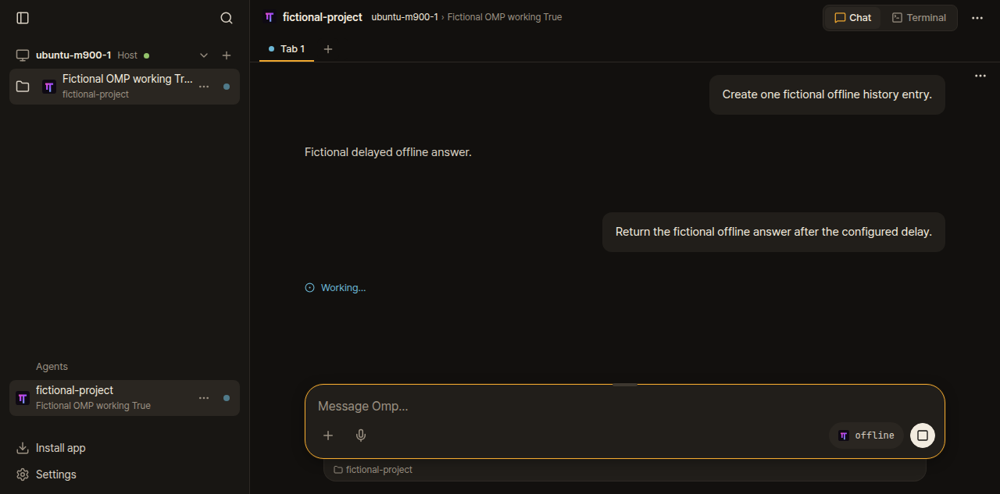

# Local OMP working status, 2026-10-16

A plain OMP pane on the host had no official Herdr integration installed. Native
Herdr reported idle through `default_known_agent_idle_fallback`, so Chat had no
working status to display. The app was already running fork revision `883f2b6`.
The earlier deployment checks missed this host's absent integration.

Installed the official v10 hook using `herdr integration install omp`. Existing
user processes were left running and need to restart/resume to load it.

The owned native probe used the actual OMP 18.4.2 binary and Herdr 0.9.5. It
replied through a fixed 15-second offline provider, with no live model calls:

| Integration loaded automatically from its default directory | Busy interval | After reply |
| --- | --- | --- |
| No | 49 idle samples | Idle, no reported session |
| v10 | 2 idle, then 48 working samples | Idle, session reported |

Agent-browser then opened an owned real OMP session with one completed offline
reply. While its second offline reply was pending, Chat showed the saved messages
and **Working…**, with no conversation-unavailable fallback. The screenshot
below is that owned session. Native status was working in all 48 samples taken
after the browser check, then returned to idle. Temporary native and web servers
were stopped afterward. No user pane was prompted, resized or restarted.

An earlier fresh-session browser check showed Working alongside the transcript
fallback; it did not verify saved history. Another attempt failed before agent
detection because the temporary home hit its disk quota extracting a native
library. The final run reused the extracted library and checked saved history.
These fixture limitations are separate from the missing host integration.

No application code changed for this setup correction. Personal evidence is on
this orphan fork branch, outside upstream application changes.
