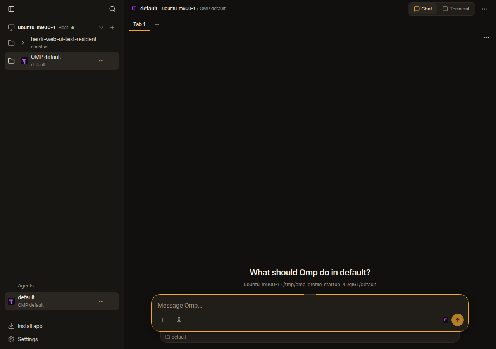
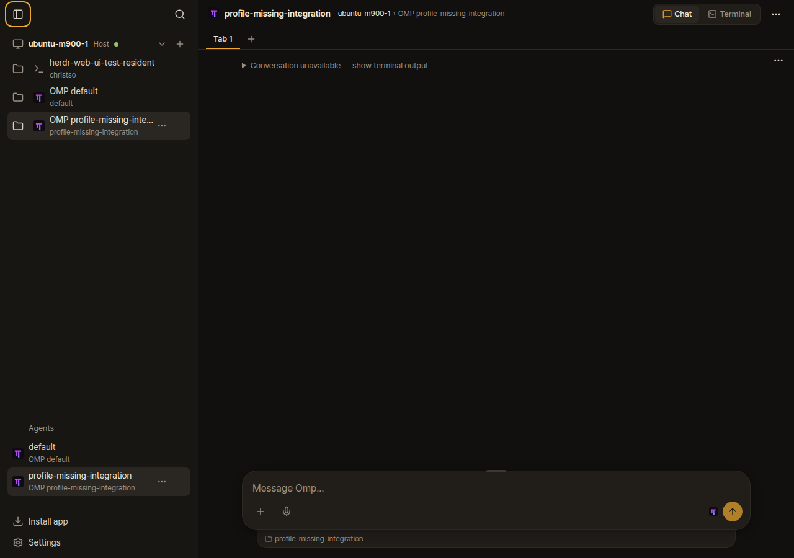
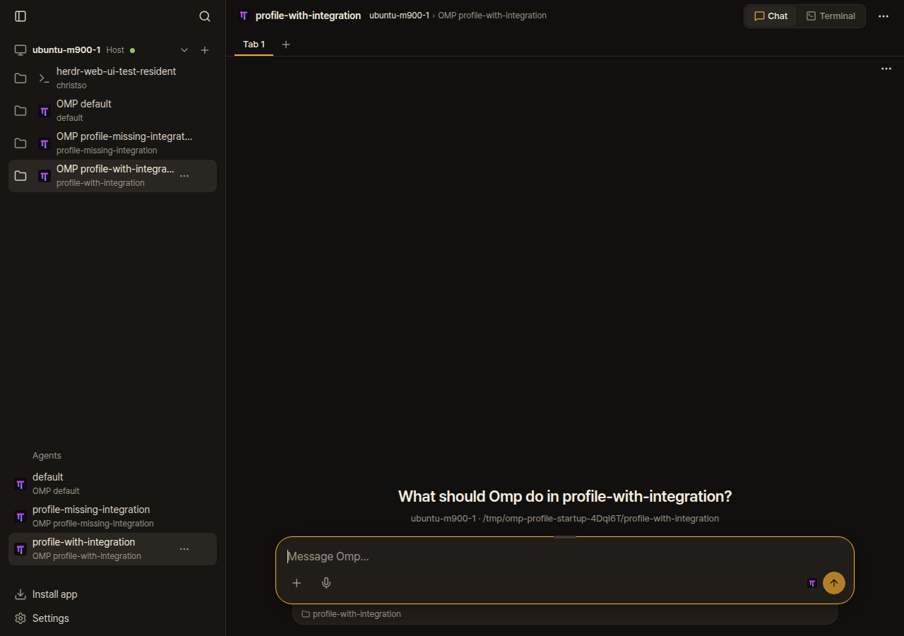

# Fresh OMP with a named profile

OMP 18.11.1, Herdr 0.9.5 and the full web app at fork integration commit 79fdf4313da9c8af8b1bddd7497319daf0b45dbb. Agent-browser CLI captured three disposable native panes, with temporary homes and an offline provider that throws if a model is called. No messages or model calls were made.

The default profile had the official Herdr extension (v8) and opened the greeting. A named compound-engineering profile had no Herdr extension: native Herdr recognized OMP but had no agent_session, and Chat showed Conversation unavailable. Installing the official integration v10 into that profile restored the native session and greeting in a new OMP launch. No web UI source change was needed.

| Default profile | Custom profile missing extension | Same profile with extension |
| --- | --- | --- |
|  |  |  |

To install into this profile on the machine that runs OMP:

```sh
PI_CONFIG_DIR=.omp/profiles/compound-engineering herdr integration install omp
omp --profile compound-engineering
```

The installer writes ~/.omp/profiles/compound-engineering/agent/extensions/herdr-omp-agent-state.ts. The second command must run in a new Herdr tab, then open its Chat view before sending anything. Merely setting OMP_PROFILE does not select the installer's destination. Existing agents are not restarted by installation and do not automatically load a new extension.

This is a configuration finding, separate from Pi custom-directory lookup (#1193/#1194) and the fresh terminal-launched Codex request (#1191). These screenshots show synthetic test panes, not private conversations.
