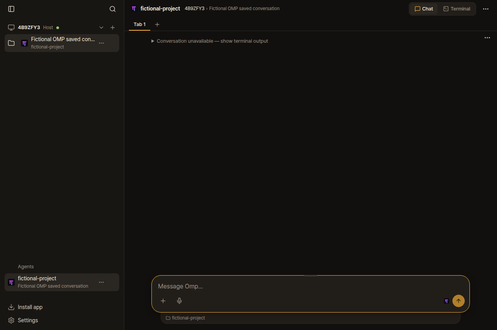
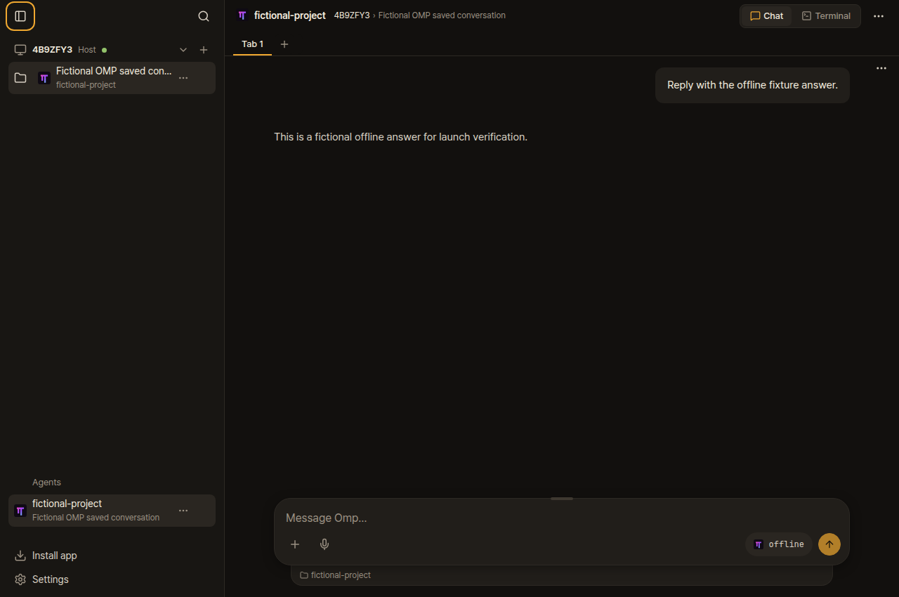

# Upstream review refresh — 17 October 2026

Evidence is kept on the fork's orphan branch, outside application PRs.

## OMP conversation lookup (#1157)

Rechecked final PR head `53051d4b13fea09798de4fb91cc1d920ed647aa1` with real OMP 18.11.1 and Herdr 0.9.5 on WSL2. An isolated named Herdr resumed a fictional two-turn saved conversation. Herdr naturally omitted the recognized OMP process arguments and reported no conversation file; no RPC metadata was injected.

The red runtime uses this PR's frontend/backend with only `server/omp.ts` replaced by upstream `95507e2ea66c53eefaed58dd923ec21111118a2e`. The green runtime restores the exact PR file. Both read the same running OMP process. Agent-browser verified the warning before and the exact two saved turns afterward, on desktop and phone. The screenshots show fictional content. No model calls or user-pane input were used. The user's native Herdr socket was preserved.

[Machine-readable report](1157-native/browser-report.json), [fixture controller](1157-native/controller.py), [fictional transcript](1157-native/fixture.json), and [runtime file hashes](1157-native/files.json).

The controller accepts a directory containing `runtime.tar.gz`, `files.json`, `fixture.json` and `omp-baseline.ts`. Build the runtime from the exact PR head with `bun install --frozen-lockfile` and `bun run build`; archive `server`, `shared`, `dist` and `package.json`, excluding test files. Hash each archived file with SHA-256 into `files.json`. Obtain the comparison resolver with `git show 95507e2ea66c53eefaed58dd923ec21111118a2e:server/omp.ts > omp-baseline.ts`. On the WSL test PC, run `python3 controller.py /absolute/path/to/bundle`. Its JSON stdout announces the isolated HTTP port and pane; tunnel that loopback port to the browser. Send `green` on stdin to swap only the resolver, then `stop` to clean up its named Herdr and web app. This controller uses the existing remote-v30 dependency directory; the tested PR and deployed runtime had identical production dependency declarations and lockfile.

For a fully scripted native default/named-profile reproduction, see the [earlier offline runner and commands](https://github.com/christso/herdr-web-ui/blob/97f17ee3d467fec6cc09b42dea8b3cfa8d1d6de5/docs/omp-native-wsl-repro/README.md). That check passed three runs on the same bounded resolver. This refresh adds browser proof for the final PR implementation; it does not reproduce the WSL kernel hang itself.

| Before | After |
| --- | --- |
|  |  |

## OMP weekly compatibility check (#1187)

Refreshed PR head `640c4401b260c6a0a4b69453083664365270bf5c` includes upstream `95507e2`, including the merged question parser fix. The native harness passed OMP 18.10.4 and latest stable 18.11.3 on desktop and phone. It selected a non-default answer, multiple choices, custom text and a wrapped answer, then submitted review and verified exactly what native OMP received. Both runs used parser SHA-256 `0c4966693c5332530a582a95dfda1295e0a5856e4a92421f09967caddaf37316`.

Commands, with each OMP installed in a disposable prefix:

```sh
OMP_BIN=/absolute/path/to/omp OMP_VERSION=18.11.3 \
OMP_COMPAT_OUT=/absolute/path/to/results \
AGENT_BROWSER_EXECUTABLE_PATH=/usr/bin/google-chrome TMPDIR=/dev/shm \
bun run check run bun scripts/omp-question-compat.ts --build
```

Repeat with `OMP_VERSION=18.10.4` and its executable. The fake provider needs no API key or model call. [Baseline report](omp-18.10.4/report.json), [latest report](omp-18.11.3/report.json). `bun run check fast` passed 4,162 tests, eight skips, no failures; workflow syntax, generated types, typecheck and build passed. Independent Standards and Spec reviews found no issues.

## Unrelated CI failures (#1192 / #1248)

`server/skills/walk.test.ts:35` assumes filesystem directory order. The unchanged test fails with the two correct rows reversed on disk-backed temporary directories, but passes on tmpfs. Separate PR #1251 sorts the actual rows before the same exact assertion. Both expected rows, descriptions, duplicate detection and cardinality remain checked. All CI jobs passed on its head `d721b3a`; production code is unchanged.

On exact #1248 head `c5accd5`, the complete unchanged `checkSplitView` browser helper passed, including the duplicated-split closing/echo scenario that failed in hosted CI. [Runner](1248-split-only.ts) and [output](1248-split-only.log). It ran in an isolated Herdr through `bun run check run`, not against user panes. A fresh full UI-contexts run stopped earlier in a different unchanged check, `secret-input-regression.ts:165` (typed-secret visibility), before reaching split view. Therefore this is a targeted split-view pass, not a claim that the full browser suite passed locally. Existing assertions were preserved.
