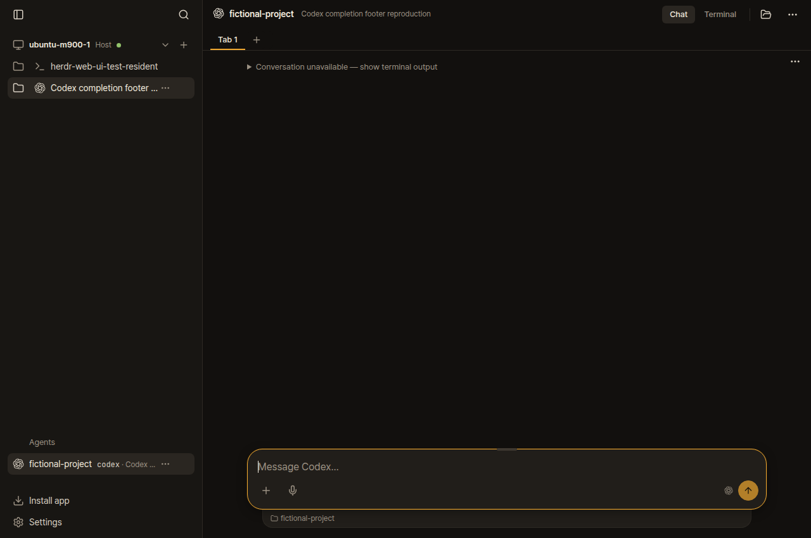
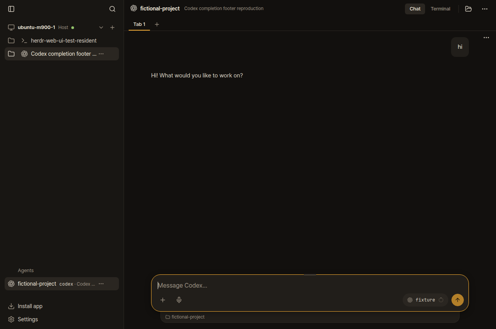
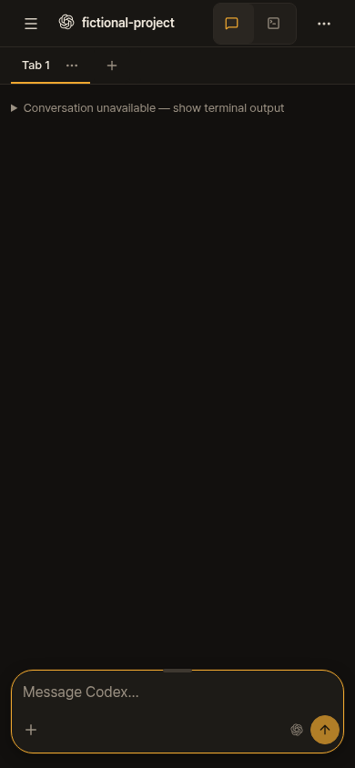
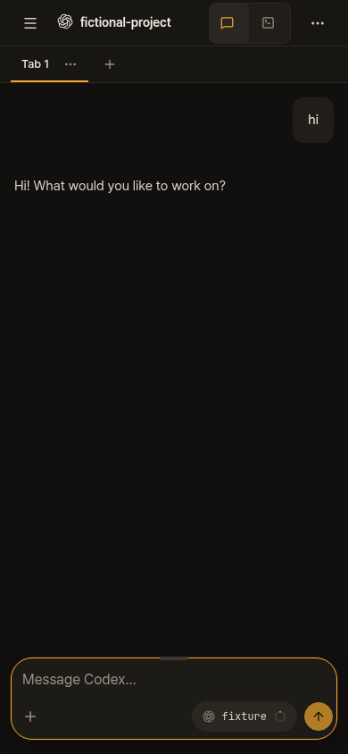

# Upstream 0.4.11 sync and cleanup — 2026-10-17

The published `christso/main` branch and this host run `5d6e91a71647b9ad5eb20c9f846689bbfac54778`.
It merges upstream `95507e2ea66c53eefaed58dd923ec21111118a2e` without rewriting our shared history.
The fork's plain `main` branch was fast-forwarded to that upstream commit.

Upstream includes our merged PRs #1155, #1184 and #1194, alongside the earlier sidebar fix.
The merge preserves upstream's newer parser and incremental Codex scan cache, plus our profiles,
launchers, separate session stores, completion-footer match and legacy clipped OMP hints.
Independent Standards and Spec reviews found no remaining issues in the merge resolutions.

## Verification

- Fast checks: 4,205 passed, zero failures, eight skipped; types, workflow syntax and build passed.
- Isolated Codex binding, agent-profile, Pi and OMP contracts: 29 passed, zero failures.
- Real Codex 0.163.0 in isolated Herdr 0.9.5 reproduced the completion-footer failure on unchanged
  upstream, then showed both saved turns with the merged fork. Agent-browser checked desktop and phone.
  The local canned provider made no live model calls.
- Separate profile browser replay passed before and after the first reply for default Codex,
  a native profile, Compound and Tsoyang. These use synthetic client output; the native replay
  separately covers Codex's real completion footer.
- The phone worktree creation/selection regression passed, including Back/Forward before its roster arrives.
- Production agent-browser checks passed on desktop and phone: sidebar and existing chat rendered,
  with zero browser errors. No terminal attachments, input or user screenshots were taken.

The first combined browser harness reused a daemon started with the native fixture's environment;
the later synthetic fixture therefore could not start. Running each fixture in its own isolated
Herdr check fixed the harness setup. No application change or assertion was needed.

## Deployment

Spectre runs `remote-v30-christso-5d6e91a` through its stable `remote-v30` link. Its binaries and
dependencies came from the existing verified runtime; dependency versions did not change in this
sync. The new server, shared code and built assets were overlaid and all 1,616 file hashes verified.
Import and native PTY smoke checks passed before activation. Only the authenticated, identity-checked
managed web bridge was restarted. Its live identity reports bridge version 30.

The host plugin was installed from the exact fork SHA. Both native Herdr socket identities were
preserved, as were all 38 recorded local agent/Herdr processes, token configuration, paired devices
and profile settings. Two existing Codex conversations remained available after deployment.

WTG was not contacted or upgraded. While the host plugin was stopped, only WTG's local `enabled`
flag was changed to false to prevent automatic reconnection. Its registration, SSH target and cached
roster remain. A mode-0600 backup of the previous machine file is in the private artifact directory.

## Cleanup and open work

Removed 13 completed local branches and four clean worktrees, including the temporary upstream
sync branch/worktree after deployment. Three finished agent workspaces belonging to the removed
worktrees were closed. Open PR branches and the separate orphan evidence branch were retained.

PR #1248 already uses this upstream base; it needs no rebase. Its completed CI has unrelated failures
in the unchanged skills-directory order test and Claude split-terminal browser test. The requested
retry requires upstream administrator rights; a maintainer-facing comment records the evidence.

PR #1192's conflicts were resolved against current upstream, retaining only its three focused files.
Its 302 prompt tests pass, existing upstream test assertions remain unchanged, and both independent
reviews found no issues. Fast checks then passed: 4,163 tests, zero failures, eight skips, plus
types, build and workflow syntax. The first run had one failure in an unchanged Portal process-identity
test; a focused rerun and the full rerun passed without changes. This is a normal merge refresh,
not a force-push.

Private scripts, backups and verification reports are under
`/home/christso/.cache/herdr-upstream-sync`. They are outside application branches.

## Isolated native replay

